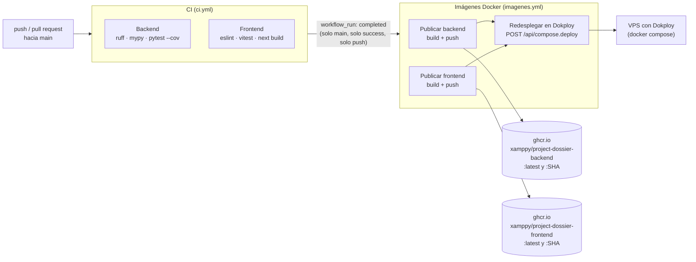

# Evidencia: integración y entrega continuas (GitHub Actions)

Atiende la observación del docente sobre **integración continua**. Todo lo de esta carpeta se obtuvo
el 2026-10-19 con `gh` autenticado contra `Xamppy/Project-Dossier`, sobre el commit
`9f6c69250fbff63b7375d965d5692cf1c494ff30` (merge del PR #24). Cada `.txt` tiene en su encabezado la
fecha, el comando exacto y el código de salida; el `.png` homónimo es la misma salida renderizada.

## Los dos workflows

| Workflow | Archivo | Disparador | Qué hace |
|---|---|---|---|
| **CI** | [`.github/workflows/ci.yml`](../../../../.github/workflows/ci.yml) | `push` a `main` y `pull_request` hacia `main` | Job **Backend**: Python 3.12, `ruff check src/dossier`, `mypy src/dossier`, `pytest --cov`. Job **Frontend**: Node 20, `npm ci`, `npm run lint`, `npm test` (Vitest), `npm run build`. Sin `continue-on-error`: si falla un paso, el check queda en rojo. |
| **Imágenes Docker** | [`.github/workflows/imagenes.yml`](../../../../.github/workflows/imagenes.yml) | `workflow_run` de CI terminada, solo en `main` (y `workflow_dispatch`) | Matriz `backend`/`frontend`: login en ghcr.io, `docker/build-push-action` con etiquetas `latest` y el SHA, caché de GitHub Actions. Luego el job **Redesplegar en Dokploy** llama a `POST /api/compose.deploy`. `concurrency: imagenes-docker` con `cancel-in-progress: true`. |

El texto completo de ambos archivos está en [06-workflows.txt](06-workflows.txt).

## Archivos

| Evidencia | Qué muestra |
|---|---|
| [01-ultimas-30-ejecuciones.txt](01-ultimas-30-ejecuciones.txt) · [png](01-ultimas-30-ejecuciones.png) | Las últimas 30 ejecuciones con workflow, rama, evento, conclusión, duración y SHA. Resumen: **23 success, 6 cancelled, 1 failure**. |
| [02-ci-main-exitosa.txt](02-ci-main-exitosa.txt) · [png](02-ci-main-exitosa.png) | CI #40 en `main` (id `39281960171`, merge del PR #24): los dos jobs y todos sus pasos en verde (Frontend 2m5s, Backend 56s). |
| [03-imagenes-docker-exitosa.txt](03-imagenes-docker-exitosa.txt) · [png](03-imagenes-docker-exitosa.png) | Imágenes Docker #14 (id `39285005560`) sobre el mismo SHA: publicar backend, publicar frontend y redesplegar, en verde. |
| [04-imagenes-docker-9-fallida.txt](04-imagenes-docker-9-fallida.txt) · [png](04-imagenes-docker-9-fallida.png) | La única falla de la ventana: Imágenes Docker #9 (id `39279047309`). |
| [05-imagenes-docker-10-exitosa.txt](05-imagenes-docker-10-exitosa.txt) · [png](05-imagenes-docker-10-exitosa.png) | Imágenes Docker #10 (id `39281671569`) en verde, y `git diff --stat 29eb532 7d9c38b -- .github/workflows/imagenes.yml` vacío: el workflow no cambió entre #9 y #10. |
| [06-workflows.txt](06-workflows.txt) · [png](06-workflows.png) | Contenido de `ci.yml` e `imagenes.yml`. |

**Cómo se mide la duración.** La herramienta
[`_herramientas/tabla_ejecuciones.py`](../_herramientas/tabla_ejecuciones.py) toma, por ejecución, el
inicio del primer job y el término del último (`gh run view --json jobs`). La columna de `gh run list`
usa `updatedAt`, que GitHub mueve después de terminar (por ejemplo, al encolar el `workflow_run`
dependiente) y da duraciones infladas de 20 a 30 minutos. Las canceladas antes de arrancar un job
aparecen con «-».

## Lectura honesta de las fallas y cancelaciones

- **Imágenes Docker #9 falló por la red, no por el código.** El job *Publicar backend* se cayó en
  `docker/login-action` con
  `Error response from daemon: Get "https://ghcr.io/v2/": ... context deadline exceeded (Client.Timeout exceeded while awaiting headers)`
  (línea 42 de [04-imagenes-docker-9-fallida.txt](04-imagenes-docker-9-fallida.txt), en las anotaciones).
  *Publicar frontend* no falló por sí mismo: la matriz lo canceló (`The strategy configuration was canceled because "publicar.backend" failed`),
  y *Redesplegar en Dokploy* no llegó a correr. La ejecución #10 usó el mismo `imagenes.yml`, con las
  mismas versiones de acciones fijadas por SHA, y terminó en verde. `gh run view --log-failed` no devolvió
  líneas que coincidieran con el filtro; el mensaje está en las anotaciones del job.
- **Las 6 canceladas son esperadas.** `imagenes.yml` declara `concurrency: { group: imagenes-docker, cancel-in-progress: true }`.
  El 2026-10-19 se mezclaron varios PR seguidos; cada CI verde en `main` disparó un `workflow_run`
  y cada uno nuevo canceló al anterior. Solo importa que el último de cada ráfaga publique la imagen del SHA más reciente.
- **El redespliegue en Dokploy todavía no es automático.** En #10 y #14 el job *Redesplegar en Dokploy*
  terminó en verde, pero por la rama de aviso: la anotación dice
  `Faltan los secretos DOKPLOY_URL, DOKPLOY_API_KEY o DOKPLOY_COMPOSE_ID: imágenes publicadas, sin redespliegue automático.`
  Las imágenes sí se construyen y se publican en ghcr.io; el último paso del diagrama queda listo para
  cuando se carguen esos tres secretos en el repositorio.
- **La CI aún no levanta Postgres.** Las 109 pruebas que necesitan una base real se omiten en Actions
  (`TEST_DATABASE_URL` no definida) y se ejecutaron localmente para esta evidencia: ver
  [../almacenamiento/](../almacenamiento/README.md).

## Capturas de GitHub Actions pendientes de tomar cuando el repo sea público

El repositorio es privado. Al abrir `https://github.com/Xamppy/Project-Dossier/actions` con Chrome DevTools
(sin sesión iniciada) GitHub responde «Page not found». No se ingresaron credenciales. Cuando el repo sea
público, o desde una sesión con acceso, capturar:

1. Lista de ejecuciones: https://github.com/Xamppy/Project-Dossier/actions
2. CI exitosa en `main` (CI #40): https://github.com/Xamppy/Project-Dossier/actions/runs/39281960171
3. Imágenes Docker exitosa (#14): https://github.com/Xamppy/Project-Dossier/actions/runs/39285005560
4. Opcional, la falla explicada arriba (#9): https://github.com/Xamppy/Project-Dossier/actions/runs/39279047309

Mientras tanto, las salidas de `gh` de esta carpeta contienen la misma información (jobs, pasos, conclusión, anotaciones).

## Tabla de las 30 ejecuciones

| id | workflow | rama | evento | conclusión | duración | sha | creada (UTC) |
|---|---|---|---|---|---|---|---|
| 39286073936 | CI #42 | docs/DOC-2026-10-19-01-siete-idiomas | pull_request | success | 2m03s | 14e7ced | 2026-10-19 16:31 |
| 39285864680 | CI #41 | chore/CHORE-2026-10-19-03-ci-sha-buildx | pull_request | success | 2m22s | 97c727a | 2026-10-19 16:29 |
| 39285560128 | Imágenes Docker #15 | main | workflow_run | success | 0m35s | 9f6c692 | 2026-10-19 16:27 |
| 39285005560 | Imágenes Docker #14 | main | workflow_run | success | 0m40s | 9f6c692 | 2026-10-19 16:23 |
| 39283038549 | Imágenes Docker #13 | main | workflow_run | success | 1m37s | 9f6c692 | 2026-10-19 16:07 |
| 39282956167 | Imágenes Docker #12 | main | workflow_run | cancelled | 1m24s | 9f6c692 | 2026-10-19 16:07 |
| 39282883939 | Imágenes Docker #11 | main | workflow_run | cancelled | 0m34s | 9f6c692 | 2026-10-19 16:06 |
| 39281960171 | CI #40 | main | push | success | 2m05s | 9f6c692 | 2026-10-19 15:58 |
| 39281947711 | CI #39 | chore/harness-traspaso-2026-10-19 | pull_request | success | 2m06s | a07a0fe | 2026-10-19 15:58 |
| 39281694016 | CI #38 | chore/CHORE-2026-10-19-01-agent-rules-next | pull_request | success | 2m17s | a9f3716 | 2026-10-19 15:56 |
| 39281671569 | Imágenes Docker #10 | main | workflow_run | success | 3m57s | 7d9c38b | 2026-10-19 15:56 |
| 39281276617 | CI #37 | fix/BUG-2026-10-19-03-dashboard-movil | pull_request | success | 1m46s | 729d744 | 2026-10-19 15:53 |
| 39281159366 | CI #36 | fix/BUG-2026-10-19-04-contacto-falso-positivo | pull_request | success | 2m40s | f82a8ec | 2026-10-19 15:52 |
| 39281083738 | CI #35 | main | push | success | 3m22s | 7d9c38b | 2026-10-19 15:51 |
| 39281060804 | CI #34 | chore/harness-cierre-revisiones | pull_request | success | 3m05s | 20131f1 | 2026-10-19 15:51 |
| 39280907934 | CI #33 | fix/BUG-2026-10-19-01-bcrypt-cambio-contrasena | pull_request | success | 1m34s | cc52a42 | 2026-10-19 15:49 |
| 39280859218 | CI #32 | chore/CHORE-2026-10-19-02-vitest-node26 | pull_request | success | 1m53s | 65000bd | 2026-10-19 15:49 |
| 39280835573 | CI #31 | fix/BUG-2026-10-19-02-pdl-correo-asistente | pull_request | success | 2m08s | 3de0a3c | 2026-10-19 15:49 |
| 39279735454 | CI #30 | main | push | success | 2m22s | 4e55155 | 2026-10-19 15:40 |
| 39279717330 | CI #29 | fix/BUG-2026-10-14-01-registro-bcrypt | pull_request | success | 3m25s | 4867a06 | 2026-10-19 15:39 |
| 39279129366 | CI #28 | main | push | success | 2m34s | ed3626e | 2026-10-19 15:35 |
| 39279107317 | CI #27 | feat/S5.4-resultados-parciales-agentes | pull_request | success | 5m29s | 191745e | 2026-10-19 15:34 |
| 39279047309 | Imágenes Docker #9 | main | workflow_run | failure | 4m56s | 29eb532 | 2026-10-19 15:34 |
| 39278983778 | Imágenes Docker #8 | main | workflow_run | cancelled | - | 29eb532 | 2026-10-19 15:34 |
| 39278947092 | Imágenes Docker #7 | main | workflow_run | cancelled | - | 29eb532 | 2026-10-19 15:33 |
| 39278868519 | CI #26 | main | push | success | 9m17s | 29eb532 | 2026-10-19 15:33 |
| 39278846489 | Imágenes Docker #6 | main | workflow_run | cancelled | - | 6952039 | 2026-10-19 15:32 |
| 39278836939 | CI #25 | feat/S5.10-progreso-etapas-parciales | pull_request | success | 4m05s | 5b1ce9e | 2026-10-19 15:32 |
| 39278712455 | Imágenes Docker #5 | main | workflow_run | cancelled | 6m02s | 6952039 | 2026-10-19 15:31 |
| 39278533520 | CI #24 | main | push | success | 6m08s | 6952039 | 2026-10-19 15:30 |

Instantánea tomada el 2026-10-19 a las 20:19 (-0300); reproducir con `python docs/evidencias/fase2/_herramientas/tabla_ejecuciones.py 30`.
