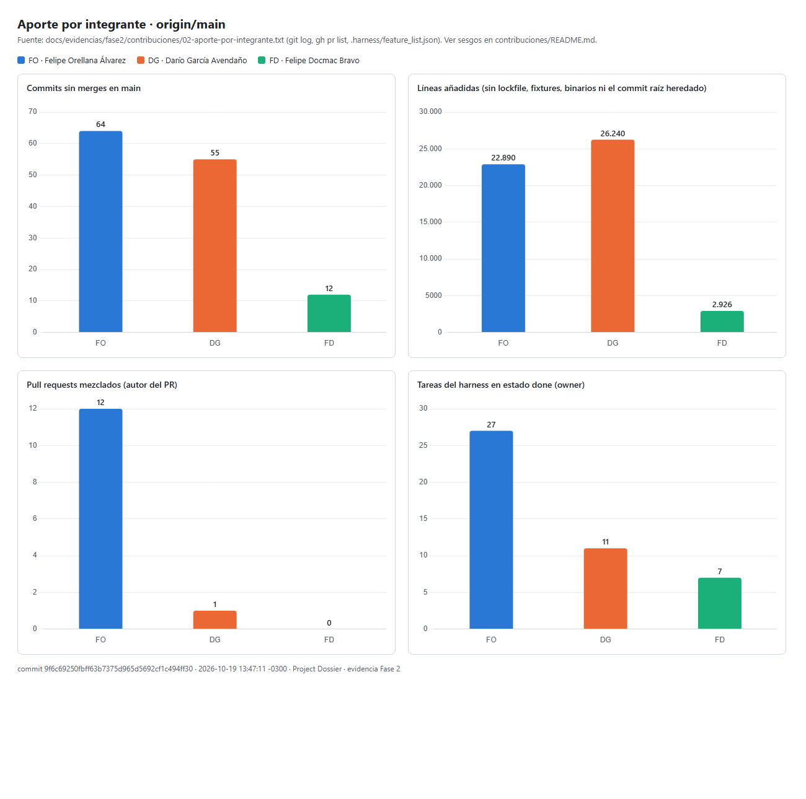

# Evidencia: aporte de cada integrante

Atiende el criterio de la rúbrica: «evidencias claras dentro del repositorio del aporte de cada uno de los
integrantes». Calculado el 2026-10-19 sobre `origin/main` en el commit
`9f6c69250fbff63b7375d965d5692cf1c494ff30`, con [`_herramientas/contribuciones.py`](../_herramientas/contribuciones.py).

## Alias de git

Verificados con `git shortlog -sne --all` ([01-git-shortlog-autores.txt](01-git-shortlog-autores.txt) · [png](01-git-shortlog-autores.png)):

| Integrante | Sigla | Autores de git |
|---|---|---|
| Felipe Orellana Álvarez | FO | `Xamppy <fe.orellanaa@duocuc.cl>` y `Felipe Orellana <134563505+Xamppy@users.noreply.github.com>` (este segundo solo aparece en los 17 merges de PR hechos desde la web de GitHub) |
| Darío García Avendaño | DG | `darygod <dari.garcia@duocuc.cl>` y `darygod <134294253+darygod@users.noreply.github.com>` (1 merge desde la web, PR #2) |
| Felipe Docmac Bravo | FD | `Felipe Docmac <fe.docmac@duocuc.cl>` |
| (automatización) | bot | `dependabot[bot]`: 5 actualizaciones de acciones de GitHub |

No hay otros autores en el historial.

## Cifras ([02-aporte-por-integrante.txt](02-aporte-por-integrante.txt) · [png](02-aporte-por-integrante.png))

| | FO | DG | FD |
|---|---:|---:|---:|
| Commits sin merges en `main` | **64** | **55** | **12** |
| … con `Co-Authored-By` (asistidos por un agente) | 62 | 49 | 9 |
| Líneas añadidas* | 22.890 | 71.683 | 2.926 |
| Líneas añadidas* sin el commit raíz | **22.890** | **26.240** | **2.926** |
| Líneas quitadas* | 848 | 3.542 | 475 |
| Archivos distintos tocados* | 212 | 389 | 82 |
| PR mezclados como autor | 12 | 1 | 0 |
| PR abiertos como autor | 9 | 0 | 0 |
| PR que mezcló | 17 | 1 | 0 |
| Tareas del harness `done` | 27 | 11 | 7 |
| Tareas del harness `review` | 6 | 0 | 0 |
| Tareas del harness `pending` | 9 | 13 | 13 |
| Primer y último commit | 09-09 → 10-19 | 09-06 → 10-14 | 09-23 |

\* Sin `package-lock.json`, `specs/fixtures/`, imágenes ni `.docx`/`.pdf`. Los binarios no suman líneas.
Además hay 12 tareas con owner `EQ` (equipo completo): 4 `done`, 8 `pending`.



[aporte-por-integrante.png](aporte-por-integrante.png): barras por integrante (commits, líneas sin el commit
raíz, PR mezclados y tareas `done`), hecho con Chart.js 4.4.1 desde el JSON de `contribuciones.py`
([`_herramientas/grafico_contribuciones.py`](../_herramientas/grafico_contribuciones.py)).

## Sesgos de estas cifras (léanse antes de comparar)

1. **El commit raíz es el sistema heredado.** `ac95553` («Initial commit: Dossier frontend and backend»,
   DG, 2026-09-06, 267 archivos, 53.529 líneas) importa el código que ya existía: este es un proyecto de
   continuidad. Por eso la tabla separa las líneas sin ese commit (DG: 45.443 de sus líneas vienen de ahí).
2. **Los merges los firma quien mezcla, no quien escribió.** FO mezcló 17 de los 18 PR cerrados, incluidos
   los 5 de dependabot. Los merges no se cuentan como commits ni suman líneas. El trabajo de DG entró además
   por merges de ramas (`dario` → `FO`, commit `93781e6`, y `Merge branch 'FO' into dario`), no solo por PR:
   el conteo de PR subestima su aporte; sus commits sí aparecen con su autoría.
3. **Asistencia de agentes.** 120 de los 136 commits sin merges llevan `Co-Authored-By` de un modelo de
   Claude (70 Opus 5.5, 27 Sonnet 5, 17 Sonnet 5.5, 6 Opus 5; un commit puede tener más de uno). El autor
   de git es la persona que dirigió la sesión, revisó y firmó el commit. Las líneas miden volumen, no esfuerzo
   ni dificultad.
4. **FD y la rama `docmac`.** Sus 12 commits son del 2026-09-23 (Tarea A3: Alembic, ruff y mypy, CI
   bloqueante, aislamiento de la suite y versiones fijadas). Se verificó cómo llegaron a `main`
   ([03-integracion-rama-docmac.txt](03-integracion-rama-docmac.txt) · [png](03-integracion-rama-docmac.png)):
   - `origin/docmac` no tiene commits fuera de `main` (0);
   - la rama `FO` continuó directamente sobre `2e69f71` («consolidar Tarea A3»): el commit `8b0bc1b` de FO
     (2026-09-26) tiene a `2e69f71` como padre, así que la historia de FD se integró **sin reescribir**;
   - esa historia llegó a la línea principal de `main` con el PR #3 (`bdead9b`, 2026-10-05);
   - **no hay copias por cherry-pick**: 0 `patch-id` repetidos entre los commits de `main`, así que ningún
     trabajo de FD figura con otro autor. Sus 12 commits se cuentan completos como suyos.
5. **Las tareas del harness miden asignación**, no solo ejecución: el `owner` es quien la tiene asignada en
   el plan. Las 6 en `review` de FO esperan la revisión de un segundo integrante.
6. **PR abiertos al momento de medir:** los 9 de FO incluyen correcciones del 2026-10-19 aún sin mezclar;
   las cifras cambian a medida que se integran.

## Cómo reproducir

```bash
git fetch --all
git shortlog -sne --all
python docs/evidencias/fase2/_herramientas/contribuciones.py origin/main --json contrib.json
python docs/evidencias/fase2/_herramientas/grafico_contribuciones.py contrib.json contrib.html <sha> "<fecha>"
# luego capturar contrib.html (Chrome sin interfaz: --headless=new --screenshot)
```
