# Modelo de datos (diagrama entidad-relación)

- **Fuente:** metadatos de SQLAlchemy (`Base.metadata`) que declara `backend/src/dossier/db/models.py`.
- **Generado con:** `cd backend && python ../docs/evidencias/fase2/_herramientas/er.py` (imprime el bloque Mermaid).
- **Fecha:** 2026-10-19 13:33:19 -0300 · **commit** `9f6c69250fbff63b7375d965d5692cf1c494ff30`.
- **Imagen:** [modelo-datos.png](modelo-datos.png), renderizada con mermaid 11.4.1 (cdn.jsdelivr.net) en Chrome sin interfaz.

**Alcance, dicho con honestidad.** El ORM declara **14 tablas**; la base que deja `alembic upgrade head`
tiene **22 tablas** más `alembic_version` (ver [06-tablas-vistas.txt](06-tablas-vistas.txt)). Las ocho que
no aparecen en el diagrama existen solo en el DDL de la migración (copiado de `db/Migracion.md`):
`api_keys`, `audit_logs`, `billing_transactions`, `credit_ledger`, `dossier_corporate_records`,
`dossier_ice_breakers`, `email_integrations` y `refresh_tokens`. Lo mismo pasa con las dos vistas
(`v_critical_alerts`, `v_org_usage_stats`) y los triggers de cobro (`fn_debit_credits_on_dossier`,
`fn_credit_ledger_after_dossier_insert`). El docstring de la migración base
(`backend/alembic/versions/a3f1c9e2b7d4_baseline_migracion_md.py`) ya registra ese desfase como hallazgo.
La estructura completa de la base real está en [07-describe-tablas-principales.txt](07-describe-tablas-principales.txt)
y [08-columnas-information-schema.txt](08-columnas-information-schema.txt).

Notación: `PK` clave primaria, `FK` clave foránea, `UK` única, `"not null"` columna obligatoria.
`||--o{` = una fila padre, cero o muchas hijas (FK obligatoria); `|o--o{` = FK opcional.

```mermaid
erDiagram
    organizations {
        uuid id PK
        varchar name "not null"
        varchar slug UK "not null"
        varchar plan "not null"
        integer credits_balance "not null"
        integer credits_monthly_limit "not null"
        varchar stripe_customer_id UK
        varchar stripe_subscription_id UK
        boolean is_white_label "not null"
        varchar custom_domain
        jsonb settings "not null"
        boolean is_active "not null"
        datetime created_at "not null"
        datetime updated_at "not null"
    }
    users {
        uuid id PK
        varchar email UK "not null"
        boolean email_verified "not null"
        varchar password_hash
        varchar full_name
        text avatar_url
        varchar timezone "not null"
        varchar locale "not null"
        varchar dossier_output_language "not null"
        integer dossier_retention_days
        datetime last_login_at
        boolean is_active "not null"
        boolean is_platform_admin "not null"
        datetime created_at "not null"
        datetime updated_at "not null"
    }
    calendar_integrations {
        uuid id PK
        uuid user_id FK "not null"
        uuid organization_id FK "not null"
        varchar provider "not null"
        varchar calendar_id
        boolean is_enabled "not null"
        integer advance_minutes "not null"
        boolean skip_internal_meetings "not null"
        boolean skip_recurring_after_first "not null"
        integer min_attendees "not null"
        array domain_whitelist "not null"
        array domain_blacklist "not null"
        varchar default_depth "not null"
        boolean auto_send_email "not null"
        varchar email_cc_assistant
        text refresh_token_encrypted
        text access_token_encrypted
        datetime access_token_expires_at
        text granted_scopes
        varchar provider_subject
        varchar provider_email
        datetime revoked_at
        datetime created_at "not null"
        datetime updated_at "not null"
    }
    contacts {
        uuid id PK
        uuid organization_id FK "not null"
        uuid created_by_user_id FK "not null"
        varchar email
        varchar full_name
        varchar linkedin_url
        varchar company
        varchar job_title
        varchar domain
        array tags "not null"
        boolean is_vip "not null"
        text notes
        datetime last_dossier_at
        datetime created_at "not null"
        datetime updated_at "not null"
    }
    dossier_generation_jobs {
        uuid id PK
        uuid organization_id FK "not null"
        uuid requested_by_user_id FK "not null"
        varchar status "not null"
        varchar job_type "not null"
        varchar calendar_provider
        varchar external_event_id
        jsonb reunion_snapshot
        varchar depth_level "not null"
        varchar meeting_label
        integer credits_estimated "not null"
        integer credits_consumed "not null"
        jsonb result_payload
        text error_message
        datetime created_at "not null"
        datetime started_at
        datetime completed_at
    }
    dossiers {
        uuid id PK
        uuid organization_id FK "not null"
        uuid requested_by_user_id FK "not null"
        uuid contact_id
        varchar subject_email
        varchar subject_name
        boolean module_identity "not null"
        boolean module_corporate "not null"
        boolean module_media "not null"
        varchar depth_level "not null"
        integer credits_consumed "not null"
        varchar status "not null"
        text status_message
        jsonb dossier_data
        jsonb alerts "not null"
        array agents_activated "not null"
        array agents_failed "not null"
        array data_sources_used "not null"
        datetime generation_started_at
        datetime generation_completed_at
        integer generation_duration_ms
        varchar cache_key
        datetime cached_until
        varchar trigger_source "not null"
        uuid calendar_event_id
        uuid dossier_folder_id
        boolean email_sent "not null"
        datetime email_sent_at
        array email_recipients "not null"
        datetime created_at "not null"
        datetime updated_at "not null"
    }
    oauth_accounts {
        uuid id PK
        uuid user_id FK "not null"
        varchar provider "not null"
        varchar provider_user_id "not null"
        datetime created_at "not null"
        datetime updated_at "not null"
    }
    org_invites {
        uuid id PK
        uuid organization_id FK "not null"
        varchar email "not null"
        varchar role "not null"
        varchar token UK "not null"
        varchar status "not null"
        uuid invited_by_user_id FK "not null"
        datetime created_at "not null"
        datetime expires_at "not null"
        datetime accepted_at
    }
    org_memberships {
        uuid id PK
        uuid organization_id FK "not null"
        uuid user_id FK "not null"
        varchar role "not null"
        boolean is_primary_org "not null"
        uuid invited_by_user_id FK
        datetime joined_at "not null"
    }
    calendar_events {
        uuid id PK
        uuid calendar_integration_id FK "not null"
        uuid organization_id FK "not null"
        uuid user_id FK "not null"
        varchar external_event_id "not null"
        varchar title
        datetime starts_at "not null"
        datetime ends_at
        text meeting_url
        jsonb external_attendees "not null"
        jsonb event_snapshot
        datetime dossier_scheduled_at
        varchar processing_status "not null"
        text skip_reason
        datetime created_at "not null"
        datetime updated_at "not null"
    }
    dossier_alerts {
        uuid id PK
        uuid dossier_id FK "not null"
        varchar level "not null"
        varchar category
        varchar title
        text message "not null"
        text source_url
        jsonb sources "not null"
        datetime detected_at "not null"
        boolean is_acknowledged "not null"
        datetime acknowledged_at
        uuid acknowledged_by_user_id FK
    }
    dossier_career_entries {
        uuid id PK
        uuid dossier_id FK "not null"
        varchar company_name "not null"
        varchar job_title
        date start_date
        date end_date
        varchar start_date_text
        varchar end_date_text
        integer tenure_months
        boolean is_current "not null"
        integer gap_months_after
        boolean has_discrepancy "not null"
        text discrepancy_detail
        varchar source
        jsonb source_citation
        integer sort_order "not null"
    }
    dossier_media_mentions {
        uuid id PK
        uuid dossier_id FK "not null"
        text title "not null"
        text url "not null"
        datetime published_at
        varchar source_name
        varchar source_type
        varchar sentiment
        text summary
        numeric relevance_score
        jsonb source_citation
        varchar query_context
    }
    dossier_shares {
        uuid id PK
        uuid dossier_id FK "not null"
        uuid shared_with_user_id FK "not null"
        uuid shared_by_user_id FK "not null"
        datetime created_at "not null"
    }
    organizations ||--o{ calendar_integrations : "organization_id"
    users ||--o{ calendar_integrations : "user_id"
    users ||--o{ contacts : "created_by_user_id"
    organizations ||--o{ contacts : "organization_id"
    organizations ||--o{ dossier_generation_jobs : "organization_id"
    users ||--o{ dossier_generation_jobs : "requested_by_user_id"
    organizations ||--o{ dossiers : "organization_id"
    users ||--o{ dossiers : "requested_by_user_id"
    users ||--o{ oauth_accounts : "user_id"
    users ||--o{ org_invites : "invited_by_user_id"
    organizations ||--o{ org_invites : "organization_id"
    users |o--o{ org_memberships : "invited_by_user_id"
    organizations ||--o{ org_memberships : "organization_id"
    users ||--o{ org_memberships : "user_id"
    calendar_integrations ||--o{ calendar_events : "calendar_integration_id"
    organizations ||--o{ calendar_events : "organization_id"
    users ||--o{ calendar_events : "user_id"
    users |o--o{ dossier_alerts : "acknowledged_by_user_id"
    dossiers ||--o{ dossier_alerts : "dossier_id"
    dossiers ||--o{ dossier_career_entries : "dossier_id"
    dossiers ||--o{ dossier_media_mentions : "dossier_id"
    dossiers ||--o{ dossier_shares : "dossier_id"
    users ||--o{ dossier_shares : "shared_by_user_id"
    users ||--o{ dossier_shares : "shared_with_user_id"
```

