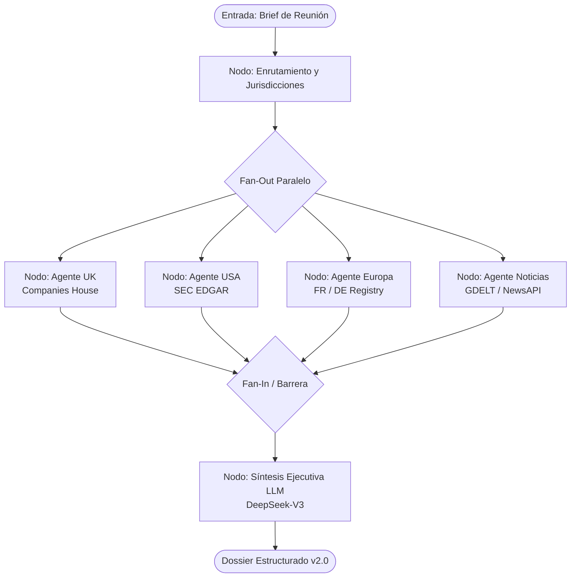

# S0.12 · Arquitectura del agente europeo y del agente de noticias en LangGraph

- **Tarea:** S0.12 · [tarjeta](https://trello.com/c/sprint0-s0-12)
- **Responsable:** FO
- **Brechas:** B2 (Registros Europeos), B3 (Agente de Noticias)
- **Estado:** acordada

## Problema

Actualmente, el grafo orquestador `backend/src/dossier/graphs/corporate_dossier_graph.py`:
1. Solo ejecuta dos agentes en paralelo: UK (`_node_agent_corporate_uk`, línea 77) y US (`_node_agent_corporate_usa`, línea 101).
2. No contempla ramas para Europa continental ni para búsqueda periodística real.
3. La tolerancia a fallos por agente está implementada con bloques `try/except` que devuelven mensajes de texto plano incrustados en Markdown, sin alimentar metadatos estructurados de `agents_activated` y `agents_failed`.

## Alcance

**Incluye:**
- Diseño del StateGraph ampliado en LangGraph con nodos concurrentes para:
  - `agent_corporate_uk` (Companies House)
  - `agent_corporate_usa` (SEC EDGAR)
  - `agent_corporate_eu` (Registros FR/DE con `eu_registry`)
  - `agent_news` (GDELT / NewsAPI)
- Nodo previo de enrutamiento y detección de jurisdicción (`_node_route_jurisdictions`).
- Nodo de síntesis convergente (`_node_synthesize_dossier`).
- Mecanismo de tolerancia a fallos por agente: si un agente externo falla, se registra en `agents_failed` y la síntesis se ejecuta con los datos parciales disponibles (S2.4, S4.9).

**No incluye:**
- El código HTTP de los clientes individuales (eso corresponde a S1.8 y S3.1).

## Diseño de Arquitectura LangGraph



### Definición del Estado (`CorporateDossierState`)

```python
from typing import TypedDict, List, Dict, Any, Optional

class CorporateDossierState(TypedDict, total=False):
    # Entradas
    participantes: str
    empresa_objetivo: str
    jurisdiction_scope: str  # "all", "uk_only", "us_only", "eu_only", "custom"
    idioma: str  # "es", "en", "en-gb", "fr", "de"
    
    # Contextos recolectados por agentes
    uk_corporate_record: Optional[Dict[str, Any]]
    us_corporate_record: Optional[Dict[str, Any]]
    eu_corporate_record: Optional[Dict[str, Any]]
    news_articles: List[Dict[str, Any]]
    
    # Trazabilidad y telemetría de ejecución
    agents_activated: List[str]
    agents_failed: List[str]
    agents_skipped: List[str]
    
    # Salida sintetizada
    dossier_payload: Optional[Dict[str, Any]]
    dossier_markdown_fallback: Optional[str]
    error: Optional[str]
```

## Criterios de aceptación

- [ ] **CA1** — Dado un brief corporativo con scope `"all"`, cuando el grafo se ejecuta, entonces dispara concurrentemente los cuatro agentes (UK, USA, EU, Noticias).
- [ ] **CA2** — Dado un fallo (HTTP 500 o timeout) en el agente europeo o de noticias, cuando el grafo converge en el nodo de síntesis, entonces el nodo de síntesis se ejecuta exitosamente marcando al agente en `agents_failed` y entregando el dossier con las demás fuentes.
- [ ] **CA3** — Dado un brief con alcance específico (ej: `"eu_only"`), cuando el enrutador lo procesa, entonces los nodos no relevantes son marcados en `agents_skipped` y no realizan llamadas de red innecesarias.

## Pruebas exigidas

| Categoría | Obligatoria | Qué cubre |
|---|:---:|---|
| Unitaria | ✅ | Estructura de transiciones del grafo y compilación del StateGraph. |
| Integración | ✅ | Ejecución del flujo con agentes simulados (fixtures con `respuesta_fija`). |
| Estrés | ✅ | Ejecución paralela de múltiples grafos concurrentes (S2.4). |
